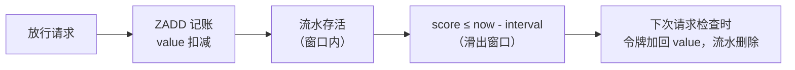

# 基础

用过的数据结构

- String
- hash (userInfo ?)
- zset (限流 / 排行榜)
- list (以前没有 stream 的时候用它做的简单 mq)
- stream

## hash

hash vs str 操作对象用 hash , 如果有 update 操作它就是优势 (直接更新某个字段) **str 还需要经历取出反序列化, 改完, 序列化放回**  所以Hash适合: 用户信息等需要频繁更新的对象


hash变更的数据 user name age,尤其是是用户信息之类的，经常变动的信息！ 

hash **更适合于对象的 存储**，String更加适合字符串存储！

```json
## string
127.0.0.1:6379> set key1 v1 # 设置值
OK

## hash
127.0.0.1:6379> hset myhash field1 kuangshen # set一个具体 key-vlaue
(integer) 1
```

## ✨zset (限流, 实际还能做排行榜)

数据结构, 跳表基本会问

*  hashTable
* skipList (跳表相当于有多条链表, L3 是高速通道, 如果找不到再往下 L2, L1 是底层完整链表) 跟电脑的多级缓存一样
  * 所以时间复杂度类似二分
  * [【编程】动画解析 Redis zset 的底层结构：跳表](https://www.bilibili.com/video/BV1uCYLeiEzw/?spm_id_from=333.337.search-card.all.click&vd_source=0f3bf62c50d57c4a7d85b89b4d2633e0)

本脚本只用到 3 个 ZSET 命令，全部围绕 **score = 时间戳**：

| 命令                           | 作用                                  | 本脚本中的用途                                         |
| ------------------------------ | ------------------------------------- | ------------------------------------------------------ |
| `ZADD key score member`        | 添加一个成员                          | 放行后记一笔账：`ZADD permits now "uuid:1:1"`          |
| `ZRANGEBYSCORE key min max`    | 取出 score 在 `[min, max]` 区间的成员 | 找出**已经滑出窗口的旧账**（score ≤ `now - interval`） |
| `ZREMRANGEBYSCORE key min max` | 删除 score 在区间内的成员             | 对完账后**删掉旧账**（闭区间，含边界）                 |



1. **数据模型**：每个维度
   1. 一把"余额"（String `:value`）
   2. 一本"流水账"（ZSET `:permits`，score = 发放时间）

`余额 + 窗口内流水之和 = count` 恒成立。

1. **滑动窗口**：放行时 `ZADD` 记账；检查时把 score ≤ `now - interval` 的旧流水换算成令牌加回余额——额度随时间滑动自动恢复，无固定窗口的临界突刺。
2. **原子性**：多条规则在一次 Lua 调用里"先全部只读检查，再统一扣减"，Redis 单线程执行脚本保证并发安全，失败路径零状态修改。


Lua 脚本两阶段执行

第一阶段（第 22-55 行）：只读检查，先算账不花钱

1. 读余额，缺 key 视为满额
2. 计算过期流水，把令牌"回流"到余额

```lua
local expired_values = redis.call("zrangebyscore", permits_key, 0, now_ms - interval)
# `math.min` 兜底，防止时钟偏差等异常情况下加超上限
current_val = math.min(max_tokens, current_val + expired_count)
```


第二阶段（第 58-75 行）：统一扣减，先删旧账再记新账

```lua
-- ① 删除阶段一计算过的过期流水（不删的话，下次请求会把同一批令牌重复回收）
redis.call("zremrangebyscore", permits_key, 0, now_ms - interval)
-- ② 记新账：本次请求消耗的令牌入流水，score = now
redis.call("zadd", permits_key, now_ms, permit_record)
-- ③ 扣余额：阶段一算好的 current_val 已包含回收量，这里连同扣减一起落库
redis.call("set", value_key, current_val - permits)
-- ④ 给两把 key 续 TTL
local expire_time = math.ceil(interval * 2 / 1000)
if expire_time < 1 then expire_time = 1 end
redis.call("expire", value_key, expire_time)
redis.call("expire", permits_key, expire_time)
```

- **④ TTL 为什么是 2 倍窗口**：TTL 只负责清理冷数据，**限流正确性靠脚本内的过期回收保证**。==如果 TTL ≤ 窗口，最后一批流水可能还没等到"下一次请求"来回收==，两把 key 就被 Redis 删了——下次请求看到 key 不存在会视为满额，等于整桶重置，滑动窗口瞬间退化成固定窗口。留 2 倍余量，让最后一次记账总有时间被回收。


**Q5：多实例部署时，时间用谁的不一致怎么办？**
每个实例用自己的 `System.currentTimeMillis()` 传入，时钟偏差会轻微影响窗口边界判断（几毫秒级），`math.min` 兜底也防止了余额加超。要求实例间 NTP 同步即可，这也是业界通行做法。


````
**NTP 同步**就是：**让计算机的系统时间和标准时间服务器保持一致。**

NTP 全称是 **Network Time Protocol（网络时间协议）**。

例如你的服务器当前时间是：

```text
服务器：2026-09-10 18:20:15
标准时间：2026-09-10 18:20:08
```

服务器通过 NTP 向时间服务器校准：

```text
你的服务器
    ↓ NTP
时间服务器
    ↓
返回标准时间
    ↓
修正服务器系统时间
```

最终变成：

```text
服务器：2026-09-10 18:20:08
```
````


## 持久化

RDB - 隔一段时间存快照二进制, 问题可能有数据丢失

AOF - 所有 set 命令追加存日志 (先存 buffer 区, buffer 到刷盘可以设置间隔例如 1 s 来落库) 会比 RDB 占的大

补个持久化对比：RDB是快照体积小恢复快但会丢最后一次快照后的数据，AOF记每条写命令更安全但文件大。线上常AOF+定期RDB配合，重启优先AOF恢复。


# RedisAdvanced_[黑马点评](https://www.bilibili.com/video/BV1PG4y1s7io/?spm_id_from=333.788&vd_source=0f3bf62c50d57c4a7d85b89b4d2633e0)

> [一个专门学习 Redis 而生的项目](https://www.bilibili.com/video/BV1cr4y1671t/?spm_id_from=333.337.search-card.all.click&vd_source=0f3bf62c50d57c4a7d85b89b4d2633e0)，参考大众点评做的。理论+实战   42h / 3 = 14
> Here the link is an instructional video, and the title link is a navigation video
>
> set: 共同关注
> zset: 排行榜应用实现，取Top N
> Geospatial 地理位置

## 一、基础篇

### 1.课程内容

> 实战篇性价比高，高级篇偏运维一点（高级、原理面试前整）


### 2.Redis的JAVA客户端

> 单单使用 Jedis 的话记得配 `JedisPool`
> 使用Spring Data Redis的话默认实现的 lettuce，如想用 Jedis 需要单独引一下
>
> 需要注意的是，如果你需要对连接池进行更高级的配置，或者使用其他的连接池实现，可能需要手动引入 commons-pool2 依赖，并进行相应的配置。但通常情况下，使用 spring-boot-starter-data-redis 默认提供的配置已经足够满足大部分需求了。
> 实测：还是需要引入commons-pool2，因为data-redis里面这个依赖是optional true
> 总之，使用 `<optional>` 标签可以控制依赖的传递性，避免不必要的依赖冲突和版本冲突，但是需要注意，它的传递性也会被取消，需要手动处理相关的依赖。   **之所以有这个问题，是因为springboot版本低了的原因，导致有这个optional。后面高版本没有这个optional了！**


#### 2.1.RedisTemplate

> RedisTemplate 记得设置一下序列化对象，直接看这个类源码有四个属性要设
> 可以看这个四个属性的类型 `RedisSerializer` 接口有哪些实现类！**一般key用RedisSerializer.string、value用json对象**，==但有下面问题！==

优势：自动处理序列化问题，不用自己代码层面转来转去了

弊端：如下，占用额外内控空间去记录该反序列化的那个类的全路径类名


#### 2.2.反序列化问题-StringRedisTemplate

> 使用上述配置序列化时，反序列化有浪费内存的问题。

##### 1）问题：


##### 2）解决

为了节省内存空间,我们并不会使用JSON序列化器来处理value,而是统一使用String序列化器,要求只能存储String类型的key和value.当需要存储java对象时,手动完成对象的序列化和反序列化.  **代码复杂了点多了两个手动序列化操作，但是空间省了**

`StringRedisTemplate`：Spring默认提供了一个StringRedisTemplate类,它的key和value的序列化方式默认就是String方式.省去了我们自定义RedisTemplate的过程


## 二、实战篇


## 1.短信登录

### 1.1.这里使用Hash保存用户信息

> JSON串的格式，引号冒号还需保存，如果想加一个还得把整个串干掉
>
> 所以从优化的角度，推荐使用hash


> 注意 Hash 结构跟 String 结构区分，这里有Redis的一个 key 而 value（K、V）才是真正的 Hash 结构
>
> ==StringRedisTemplate 对象可以创建 Hash！！！== stringRedisTemplate.opsForHash().putAll(tokenKey, userMap);【HASH，KV】
>
> Note：一般存 key 会加上业务前缀做区分


## 2.商户查询缓存

> 场景：想着自己使用spring cache技术整合Redis，用注解简化
>
> 问题：反序列化报错：我的解决 -> return list / map / String
> Could not read JSON: Cannot construct instance of `java.time.LocalDateTime`
>
> XX：衍生出的问题：缓存每次都不会命中
>
> ```
> 之前以为控制台输出了sql就是没有命中缓存，自己方法里加了log来甄别方法到底执行没。发现还是按照预期来了的
> ```

[自己 Gulimall 笔记](../GuliMall/Advanced)

[三种问题场景笔记 Redis](./Redis)

亮点：缓存穿透/击穿 可以封装成工具类，给后面复用。  例如heima的视频，就活用泛型+lambda写这个工具类

```java
public <R,ID> R queryWithPassThrough(
            String keyPrefix, ID id, Class<R> type, Function<ID, R> dbFallback, Long time, TimeUnit unit){
    
    //因为查询数据库是一段函数！！！这里就可以配合lambda这么用  有一个参数一个返回值
    R r = dbFallback.apply(id);
```


## 3.优惠券秒杀

到这里我暂时中断了，因为我发现自己并没有那么想学！

感觉不想学还是不要强行学这一块了，就学自己想学感兴趣的时间片小的东西吧。例如尝试融入leetcode拿成就感的这种。。。


## Hutools Utils

1. 复制Bean的属性，好像同Spring有个工具类一样 `BeanUtil.copyProperties`

2. 将User对象转为HashMap存储到Redis `BeanUtil.beanToMap`   org.springframework.beans的是 `BeanUtils`

   * ```java
     //由于UserDTO类有属性是Long的，而StringRedisTemplate<String, String>，所以这里用hutools构造函数定制化全给String
     //也可笨方法new map自己转成String
     Map<String, Object> userMap = BeanUtil.beanToMap(userDTO, new HashMap<>(),
                     CopyOptions.create()
                             .setIgnoreNullValue(true)
                             .setFieldValueEditor((fieldName, fieldValue) -> fieldValue.toString()));
     ```

   * **弹幕: 就这个错误，我在谷粒商城的springsession的序列化器转换异常搞了半天，也是Long类型的！！！！！！**

   * 有个问题  BeanUtil.copyProperties的ignoreNullValue不生效

   * setFieldValueEditor优先级要高于ignoreNullValue导致前者首先被触发，因此出现空指针问题。你在setFieldValueEditor中也需要判空。

     这么设计的原因主要是，如果原值确实是null，但是你想给一个默认值，在此前过滤掉就不合理了，而你的值编辑后转换为null，后置的判断就会过滤掉。

3. 和上面反着来，`JSONUtil.toBean(shopJson,Shop.class);`

4. 将Redis拿到的Hash填充到Bean `BeanUtil.fitlBeanWithMap`

5. `JSONUtil.toJsonStr`

6. 判断字符串是否为null及size小于0 `StrUtil.isNotBlank(shopJson)`

7. `BooleanUtil.isTrue(flag)`

   ```java
   Boolean flag = stringRedisTemplate.opsForValue().setIfAbsent(key, "1", 10, TimeUnit.SECONDS);
   //因为这里自动拆箱有可能null，所以用hutools
   return BooleanUtil.isTrue(flag);
   ```

