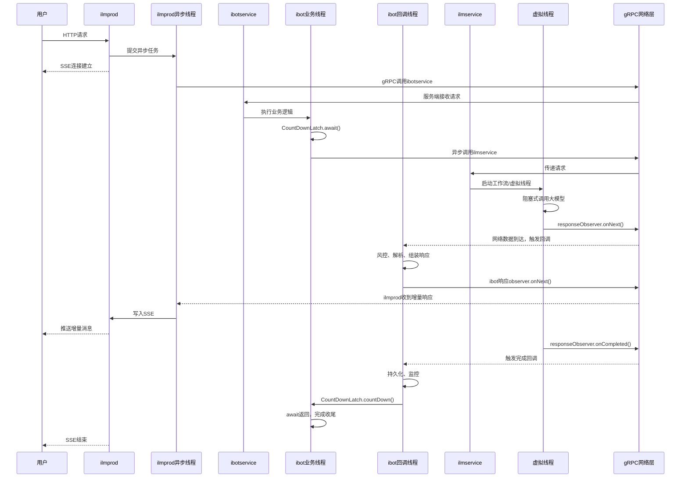

# ALMP `线程交互图,包括请求线程、回调分发线程以及虚拟线程各自的生命周期` 是怎么处理的

结合你这张活动图，关键是把 HTTP/SSE 请求线程、ibotservice 的业务线程、gRPC 的回调分发线程、ilmservice 的虚拟线程 分开看。

先明确一个核心结论：

`StreamObserver`（你说的 ObZero 对象应该是它或类似的封装）不是一个专门等待回调的线程，而是一个用于传递流式响应的回调接口。 下游调用 `onNext()`、`onCompleted()` 或 `onError()`，并不意味着上游一直有一个线程阻塞在那里等待这些方法。

不过，你这张图里还有一个容易混淆的地方：`CountDownLatch.await()` 确实可能让 ibotservice 的某个线程阻塞，但它与 gRPC 内部如何分发回调是两回事。

## 一、先还原你的业务调用链

根据图里的描述，整个过程大致是：

1. `ilmprod` 接收 HTTP 请求，准备 SSE 发射器和监视器。
2. `ilmprod` 通过 gRPC 调用 `ibotservice`。
3. `ibotservice` 做鉴权、构建上下文、加锁，并调用 `ilmservice`。
4. `ilmservice` 执行工作流，调用大模型，并通过 gRPC 流式返回增量结果。
5. `ibotservice` 收到增量结果，执行风控、消息解析等业务逻辑，再向 `ilmprod` 返回增量结果。
6. `ilmprod` 将结果写入 SSE 流，最终发送给前端。
7. 流结束后，`ibotservice` 的 `onCompleted()` 逻辑完成监控、消息持久化，并通过 `countDown()` 释放等待中的线程。

这里实际上有两条独立的流式通信链路：

- `ilmprod ↔ ibotservice`
- `ibotservice ↔ ilmservice`

每条 gRPC 流都有自己的请求处理、网络传输和回调处理过程。它们可能复用线程池，也可能在不同线程上执行，不能简单地认为整条调用链始终运行在同一个线程上。

## 二、线程交互图

下面按照你描述的实现方式，假设：

- 两次 gRPC 调用均为服务端流式响应。
- gRPC 使用异步 Stub，接收端通过 `StreamObserver` 处理结果。
- `ilmservice` 在工作流中使用虚拟线程执行阻塞式大模型调用。
- `ibotservice` 的主处理线程使用 `CountDownLatch.await()` 等待流结束。




这张图是概念上的线程分工图，不是对你们线上线程名称和调度行为的断言。特别是 `onNext()` 究竟在哪个线程执行，要看具体使用的 gRPC Stub、Executor 配置和代码调用位置。

## 三、你最关心的 Observer 到底如何回调？

以 `ibotservice → ilmservice` 为例。

### 1. 调用前：上游创建回调入口

ibotservice 使用 gRPC 异步 Stub 发起调用时，形式通常类似：

```
ilmServiceStub.chat(request, new StreamObserver<Response>() {
    @Override
    public void onNext(Response response) {
        // 处理模型节点返回的增量数据
    }

    @Override
    public void onError(Throwable t) {
        // 异常处理
    }

    @Override
    public void onCompleted() {
        // 持久化、监控、countDown()
    }
});
```

这里传入的 `StreamObserver` 是 ibotservice 本地的回调对象。

gRPC 不会把这个 Java 对象直接序列化传给 ilmservice。真正跨网络传输的是 gRPC 请求和响应消息。两端各自持有本地对象，由 gRPC 框架负责把网络响应与客户端回调关联起来。

### 2. 下游执行：虚拟线程调用模型

假设 ilmservice 在虚拟线程中调用阻塞式模型 SDK：

```
executor.submit(() -> {
    try {
        Response response = callModelBlocking();
        responseObserver.onNext(response);
        responseObserver.onCompleted();
    } catch (Exception e) {
        responseObserver.onError(e);
    }
});
```

这里的 `responseObserver` 是 ilmservice 服务端处理方法拿到的响应出口。

虚拟线程调用 `onNext()` 时，通常是把响应交给 gRPC 服务端框架，并不意味着数据此刻已经到达 ibotservice。后面仍然要经过消息编码、HTTP/2 传输、客户端解码和回调分发。

### 3. 上游收到数据：由 gRPC 驱动回调

当 ibotservice 收到响应后，gRPC 框架会调用它本地 `StreamObserver` 的 `onNext()`。

所以这里不是：

> 上游线程一直等待 Observer，等下游直接切换过来执行上游的方法。

而是：

> 上游注册回调，下游发送响应，gRPC 收到并解码响应后，再调度上游的回调逻辑。

这和 SSE 的底层机制类似：发送方写入数据，接收方通过网络连接收到数据。不过，SSE 通常由 HTTP 客户端读取流，gRPC 则由框架处理消息分帧、解码和回调分发。

## 四、那上游的线程到底是什么状态？

结合你图里的 `CountDownLatch`，可以分成三种情况。

| 线程/执行单元                 | 执行到哪里                  | 之后的状态                                   |
| ----------------------------- | --------------------------- | -------------------------------------------- |
| ibotservice 业务线程          | `countDownLatch.await()`    | 阻塞等待，直到计数归零或发生超时、中断       |
| ibotservice gRPC 回调执行线程 | `onNext()`、`onCompleted()` | 有数据时执行回调；执行完后可继续处理其他任务 |
| ilmservice 虚拟线程           | 阻塞式模型调用              | 等模型响应；返回后继续执行工作流             |

这里有个特别重要的细节：`await()` 阻塞的是调用它的线程，而不是整个 ibotservice，也不是 gRPC 的回调机制。

例如：

```
CountDownLatch latch = new CountDownLatch(1);

try {
    // 这里假设已经发起异步 gRPC 调用
    latch.await();
} finally {
    // 收到 onCompleted/onError 后，回调逻辑中执行 countDown()
}
```

如果 `await()` 所在线程是普通平台线程，那么这个线程会一直被占用，直到被唤醒。如果它是虚拟线程，阻塞时通常可以卸载底层载体线程，让载体线程去执行其他虚拟线程。

但无论是哪一种，`await()` 本身都不会帮你接收 gRPC 数据。回调能否正常执行，取决于 gRPC 的线程调度与网络处理，而不是依赖被 `await()` 阻塞的线程醒来。

还有一个风险：如果你们的回调执行任务和 `await()` 所在线程共享一个线程数有限的 Executor，并且线程都被阻塞占满，就可能发生线程饥饿甚至死锁。因此需要确认 gRPC 的 Executor 配置。

## 五、虚拟线程到底在哪一层发挥作用？

按照你的描述，虚拟线程主要用于 `ilmservice` 中的阻塞式模型调用。

1. 工作流启动

ilmservice 接到请求，启动工作流并进入模型节点。

2. 虚拟线程等待模型

如果模型 SDK 是阻塞式的，虚拟线程会等待模型返回。对于支持卸载的阻塞操作，底层载体线程可以被释放去执行其他任务。

3. 输出模型结果

模型返回后，工作流继续执行，并通过服务端 responseObserver 发送增量消息。虚拟线程不会因此自动变成 gRPC 回调线程。

注意，虚拟线程并不保证所有阻塞都能释放载体线程；具体还取决于 JDK 版本、阻塞操作及是否发生 pinning 等情况。它也不能提升模型服务自身的吞吐上限。

## 六、回到你的代码，我建议重点确认三个地方

1. `ilmservice` 是如何启动虚拟线程的？ 是每个工作流独立启动虚拟线程，还是在线程池中执行？模型调用返回后，是在同一个虚拟线程中直接调用 `responseObserver.onNext()`，还是通过其他 Executor 分发？
2. `ibotservice` 的 `CountDownLatch.await()` 在哪个线程执行？ 如果它位于 gRPC 服务端请求处理线程中，就要特别关注该线程池的容量及回调执行器是否独立。
3. `ilmprod` 到 ibotservice 的 gRPC 调用使用什么 Stub？ 是异步 Stub，还是同步阻塞式调用？这决定了 ilmprod 的等待行为，以及 SSE 的回调具体由谁驱动。

你可以优先贴出 ibotservice 调用 ilmservice 的那段代码，尤其是 gRPC Stub 调用、`CountDownLatch.await()` 和 `onNext/onCompleted/onError` 的实现。有了这段代码，就能把图中的概念线程进一步对应到真实的线程执行路径。


# 下游回调 onNext 难道不需要 ibotservice 单独出线程处理该方法里的逻辑吗 ? 此时用的是线程池中的线程 ?


是的，`ibotservice` 收到下游 gRPC 响应后，执行 `onNext()` 里面的业务逻辑，必然需要某个线程来执行，但不一定要单独创建一个线程。通常由 gRPC 的回调执行线程来执行，也可能受到你们自定义 Executor 的影响。

以你的场景为例：

1. `ibotservice` 调用 `ilmservice` 的异步 gRPC 接口。
2. `ilmservice` 调用 `responseObserver.onNext()` 发送数据。
3. 数据经过网络传输，`ibotservice` 收到响应。
4. gRPC 框架调用 `ibotservice` 注册的 `onNext()`。
5. `onNext()` 执行风控、解析消息、构建 SSE 响应等逻辑。

## 线程到底从哪里来？

ilmservice 的工作流线程

调用 responseObserver.onNext() 发送响应

gRPC 网络传输 / HTTP/2

ibotservice 的 gRPC 客户端框架

接收、解码响应，驱动回调

执行 ibotservice 的 onNext()

通常使用 gRPC 管理的执行线程，而非专门为每次回调创建新线程

这里要注意：gRPC 的网络 I/O 线程与执行 `onNext()` 业务逻辑的线程，在具体实现中可能存在关联，也可能通过 Executor 分发，不能一概认为一定是两个不同的线程。

## 那么，它使用的是线程池中的线程吗？

通常可以这样理解：使用框架管理的线程资源，而不是每次 `onNext()` 都新建一个线程。

但要区分两种情况：

- 默认配置： gRPC 管理自己的执行资源，回调通常由框架调度的线程执行。
- 自定义配置： 如果客户端或服务端配置了 Executor，相关回调或任务可能交由指定的线程池执行。

另外，你的 `onNext()` 中如果直接执行耗时的风控、数据库操作，或者其他阻塞逻辑，那么执行这些逻辑的线程也会被占用，直到方法返回。

这也是你们使用虚拟线程时需要关注的地方：即使 `ilmservice` 的模型调用已经通过虚拟线程降低了阻塞开销，`ibotservice` 的 `onNext()` 如果仍然执行大量阻塞业务，依然可能造成回调执行资源被占用。

针对你的项目，最值得确认的是：`ibotservice` 的 gRPC 客户端有没有配置自定义 Executor，以及 `onNext()` 中的风控和数据库操作是不是直接同步执行。 这两个因素决定了回调线程是否容易被阻塞。